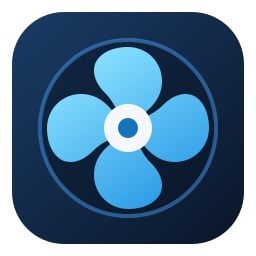

# FanOrder

[简体中文](README.md) · English



A Windows controller for the llano V12Ultra (formerly V16) AI laptop cooling pad, with temperature-based curves, manual speed control, lighting presets and system tray shortcuts.

## Features

- Automatic temperature control, manual and pure manual modes, editable curves and saved profiles.
- Fan power, speed adjustment, lighting presets and device readback.
- Tray controls, global shortcuts and optional startup in the tray after login.
- Local operating history, live trends and curve suggestions.
- Chinese and English interfaces and installers. Choose the app language under **Settings → General**; it is saved for your Windows account. Profile names and numeric values remain unchanged.
- Windows Fluent dark and classic dark appearances.
- A separate backend service owns device access. The Settings UI and CLI communicate through a local named pipe.

## Platform and prerequisites

Windows x64 and the llano V12Ultra (formerly V16) AI-controlled laptop cooling pad are supported. The specific product is JD item [100211395916](https://item.jd.com/100211395916.html), listed with filing model SV107. V11, V11 Pro, ordinary V12 and other models are outside the supported scope. The former V16 name follows that product listing and does not establish compatibility with every product named V16. Device identity and pairing verification are still required. Releases include the .NET 10 runtime. Internal executable, service and pipe identities retain `V12UltraController` for installation compatibility.

Device control requires explicit pairing and verification. Temperature monitoring uses LibreHardwareMonitor and requires the official PawnIO 2.2.0 installation separately. Vendor software, firmware and driver installers are not bundled.

## Install and use

Download the **[0.1.28 preview installer](https://github.com/tianqistudio/fanorder/releases/tag/v0.1.28-preview.20261013)** for Windows x64.

1. Exit FanOrder from the tray before installing. Choose English or Simplified Chinese in the installer. Desktop and Start menu shortcuts are independently selectable; upgrades retain existing choices, user registration, configuration and startup preferences.
2. Open Settings from a shortcut or the installation folder. Choose the interface language under **Settings → General**. Installer language and interface language are independent.
3. For first use, remain at the computer, explicitly exit Myth.Cool, and follow **Pairing, commissioning & rollback** to verify the device and commission it. Do not allow multiple programs to write to the same device.
4. Choose automatic curve control or manual speed as needed. Pure manual mode stops automatic adjustment and protection output; restoring protection requires an explicit action. Check device-confirmed status before assuming a change succeeded.
5. Edit and save profiles locally, then explicitly apply a saved profile to send it to the backend. Draft changes do not operate the device. Lighting uses device presets; the color preview does not reproduce physical brightness or animation.
6. Enable login tray startup only if desired. Closing Settings can leave tray control available; use the explicit release/exit action when relinquishing control.

Turning the fan off requires confirmation. With normal protection, fan-off is restricted by temperature and status. With automatic protection disabled, temperature changes will not automatically restart the fan. Shutdown fan-off has a separate attended qualification test and activation step and is disabled by default; Windows Restart, Fast Startup, sleep and hibernation have distinct limitations described in the UI.

Before uninstalling, exit the tray app. The backend releases ownership and restores the pre-commissioning scheduled-task state without automatically starting Myth.Cool. Recovery failure stops uninstallation. Configuration, audit records, user registration and recovery backups are retained.

## Build and test

Use the .NET 10 SDK specified by `global.json` and run from the project root on Windows x64:

```powershell
dotnet restore V12UltraController.slnx --locked-mode
dotnet build V12UltraController.slnx -c Release --no-restore
dotnet test tests/V12UltraController.Tests/V12UltraController.Tests.csproj -c Release --no-build
dotnet test tests/TianqiStudio.DesktopShortcuts.Tests/TianqiStudio.DesktopShortcuts.Tests.csproj -c Release --no-build
dotnet run --project tools/SettingsPreview -c Release -- --output artifacts/preview-new
```

Tests use simulated devices without real HID writes. Build and test commands do not install the service or commission a fan. The UI preview uses synthetic state and does not connect to the production service.

To create a new validated application candidate and NSIS installer, use unique IDs:

```powershell
./tools/New-ApplicationCandidate.ps1 -Version 0.1.28 -CandidateId bilingual-0128-new
./installer/build-nsis.ps1 -CandidateId bilingual-0128-new -BuildId bilingual-0128-new
```

The packaging workflow checks the retained official NSIS archive and compiler files. The candidate verifies application versions, tests, synthetic UI behavior and package contents. Building an installer does not execute it or verify a real installation, device commissioning or physical cooling performance.

See [installer sources](installer/README.md), [source release scope](docs/source-release.md) and each release's checksums and validation notes.

## Project structure

| Directory | Contents |
| --- | --- |
| `src/V12UltraController.Core` | Protocol, device access and core models |
| `src/V12UltraController.Service` | Control coordination, protection and local API |
| `src/V12UltraController.Settings` | WPF Settings UI and tray |
| `src/V12UltraController.Cli` | Command-line client |
| `src/TianqiStudio.DesktopShortcuts*` | Shortcut core and WPF adapter |
| `tests` | Offline regression tests |
| `tools` | Validation, diagnostics and packaging tools |
| `installer` | Installer sources and maintenance scripts |

## Copyright and third-party components

See [THIRD-PARTY-NOTICES.md](THIRD-PARTY-NOTICES.md) for third-party components and license terms. Retain the applicable upstream attribution and license terms when redistributing included components.

Made by [tianqistudio](https://tianqistudio.com/home).
